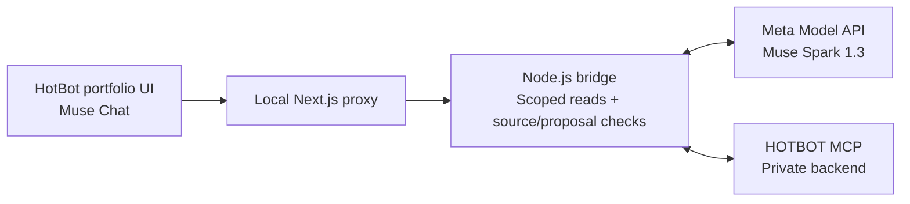

<p align="center"></p>

<h1 align="center">HotBot × Muse</h1>

<p align="center">HotBot brings the trading intelligence. Muse makes it as easy as a conversation.</p>

<p align="center"><a href="https://youtu.be/RcT1DuSwffI">Watch the demo</a> · <a href="SUBMISSION.md">Submission & rubric</a> · <a href="#workflow">Workflow</a> · <a href="#quickstart">Quickstart</a> · <a href="#verification">Verification</a> · <a href="#scope">Scope</a> · <a href="#license">MIT License</a></p>

We're building HotBot for people who want an AI trading team they can actually understand and guide. Ask what it bought. Ask why. Tell it when you want to be asked first.

That's where Muse comes in. It reads the portfolio, explains what happened and shows you a proposed change before you decide what to do. You can open the records behind its answer.

This demo uses a paper portfolio. Muse can read and propose changes here; it doesn't place trades or change settings. Our goal is simple: make using HotBot as easy as talking to Muse.

## Workflow

1. **Ask what you care about.** "Why did it buy that coin?" "Can you ask me before the next buy?"
2. **See the records.** Open the journal entry behind an answer and check what the trading team recorded.
3. **Decide what to change.** Review the current setting, the proposed change and what else it affects. Nothing changes from this chat.

The walkthrough opens with HotBot's existing portfolio setup, then shows the new Muse conversation. The user asks why HotBot passed on ELEVEN, then bought it about five minutes later. Muse compares both journal records and prepares a proposal requiring approval before ordinary trades. This is a real account’s paper history; another account will contain different records.

The walkthrough runs in a local hackathon build with real Meta responses and HotBot paper-portfolio records. The public repository contains the client and new Muse layer; the existing HotBot backend remains an external dependency.

## How Muse connects

HotBot's existing MCP server supports a custom connector in the Muse app. For this hackathon, we also put Muse Spark 1.3 inside HotBot's portfolio screen through Meta Model API. The video shows that new conversation inside HotBot.



The bridge holds provider credentials. The native UI receives read results and conversation events, never those credentials.

## Quickstart

You need **Node.js 22+**, **Bun**, a **Meta Model API key** with access to `muse-spark-1.3`, and a **read-only HOTBOT MCP token** for an accessible account with a themed paper portfolio. A consumer Muse login alone does not configure this module.

In HotBot’s Account page, open **Your agents → New key** and leave **Can trade** off. Copy the one-time key locally.

**Terminal 1, from the repository root:**

```sh
cp muse-agent/.env.example muse-agent/.env
# Fill MODEL_API_KEY and HOTBOT_MCP_TOKEN in the local .env.
cd muse-agent
node --env-file=.env server.mjs
```

**Terminal 2, from the repository root:**

```sh
bun install --frozen-lockfile --ignore-scripts
cd client
bun --bun next dev --hostname 127.0.0.1 --port 3000
```

Open **http://127.0.0.1:3000/muse-preview**, then **Chat**. The preview reuses the existing portfolio, sidebar, team panel, and styles without private Convex account startup. Ordinary app routes retain their authentication. Completed `.env` files are ignored by Git.

The private HotBot backend and hosted MCP service remain external dependencies. This source alone cannot provision account access or a portfolio. See [full setup and recording instructions](muse-agent/README.md).

## Verification

From the repository root:

```sh
(cd muse-agent && npm test)
(cd client && bun run typecheck)
```

The current implementation passed **18 isolated bridge tests**, TypeScript checking, and a separate live walkthrough. Mock transport tests do not prove a judge’s provider access works. Source checks establish provenance, not the correctness of every model interpretation or recommendation. The unvalidated holding comparison is excluded; missing MCP fields are not reconstructed.

## Scope

| Built for this submission | Existing HotBot foundation |
|---|---|
| Muse tool loop, streaming reads, source receipts, advisory proposals | Portfolios, trading agents, MCP server |
| Muse Chat integration and local MCP adapters | Native React portfolio UI, sidebars, shared contracts |

The foundation comes from [0xwhoismax/hotbot at 069a874](https://github.com/0xwhoismax/hotbot/tree/069a87403703f0c0ce22c6eef0058a82cea9afcc). [UPSTREAM_README.md](UPSTREAM_README.md) preserves its original documentation and historical rights wording byte for byte.

## License

HOTBOT-authored software in this repository is available under the [MIT License](LICENSE). Third-party dependencies, Meta’s models, and external services retain their own terms; their code and services are not licensed by this repository.
